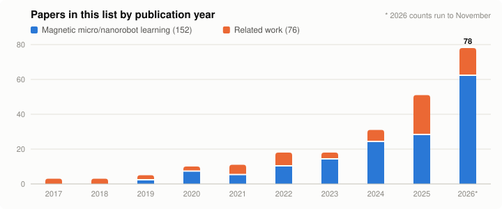
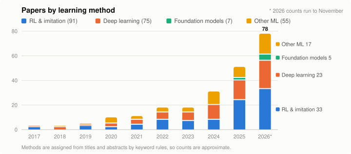

# MiNa-Learning: Awesome Magnetic Micro/Nanorobot Learning 

**Basic Info.** This repo collects academic papers about **learning for magnetic micro/nanorobotics**: machine learning, such as reinforcement learning, deep learning, Bayesian optimisation and large language models, applied to magnetically actuated micro- and nanorobots, microrobot swarms and soft magnetic millirobots. Papers are mainly grouped by the task they tackle and sorted newest first. Papers with **real robot experiments** are preferred, but simulation studies are included too because the field is still young. A few actuation-agnostic simulation papers, such as learned navigation of generic microrobots in blood vessels, sit in the core sections because they carry over directly to magnetic systems. Two **Related** sections at the end collect learning for microswimmers driven by light, sound or chemistry, and for magnetic continuum robots, catheters and capsules; the counts below call everything else **core**. Papers with **open-source code** are marked with a star 🌟.

Pull requests for new papers and code are very welcome; see [Contributing](#contributing).

**Daily updates.** A [free bot](.github/workflows/daily-update.yml) searches arXiv, OpenAlex, Crossref, PubMed and Semantic Scholar every day. Between them these sources index journals and conferences from all major publishers, including IEEE, Springer Nature, Wiley, Elsevier, ACS, RSC and MDPI. Papers the bot is unsure about wait for review in [NEW_PAPERS.md](NEW_PAPERS.md). Keyword search still misses some papers, so suggestions are welcome.

> 149 core papers + 76 related papers, 17 with open-source code (8%). Last updated: 2026-11-23.

<picture>
  <source media="(prefers-color-scheme: dark)" srcset="assets/paper_growth_dark.svg">
  
</picture>

<picture>
  <source media="(prefers-color-scheme: dark)" srcset="assets/learning_methods_dark.svg">
  
</picture>

Numbers behind the charts

<!-- stats-table:start -->

| Year      |    Core | Related | RL & imitation learning | Deep learning | Language & foundation models | Other ML & optimisation |
| --------- | ------: | ------: | ----------------------: | ------------: | ---------------------------: | ----------------------: |
| 2026*     |      59 |      16 |                      32 |            22 |                            5 |                      16 |
| 2025      |      28 |      23 |                      24 |            16 |                            2 |                       9 |
| 2024      |      24 |       7 |                       8 |            12 |                            0 |                      11 |
| 2023      |      14 |       4 |                       7 |             7 |                            0 |                       4 |
| 2022      |      10 |       8 |                       8 |             6 |                            0 |                       4 |
| 2021      |       5 |       6 |                       4 |             4 |                            0 |                       3 |
| 2020      |       7 |       3 |                       2 |             3 |                            0 |                       5 |
| 2019      |       2 |       3 |                       3 |             1 |                            0 |                       1 |
| 2018      |       0 |       3 |                       0 |             2 |                            0 |                       1 |
| 2017      |       0 |       3 |                       2 |             1 |                            0 |                       0 |
| **Total** | **149** |  **76** |                  **90** |        **74** |                        **7** |                  **54** |

\* 2026 counts run to November. Learning methods are assigned from titles and abstracts by keyword rules, so treat them as approximate.

<!-- stats-table:end -->

## Contents

- [Surveys and Perspectives](#surveys-and-perspectives) (17)
- [Control and Navigation](#control-and-navigation) (40)
- [Locomotion and Gait Learning](#locomotion-and-gait-learning) (5)
- [Manipulation and Cargo Delivery](#manipulation-and-cargo-delivery) (6)
- [Swarms and Multi-Robot Control](#swarms-and-multi-robot-control) (17)
- [Path and Motion Planning](#path-and-motion-planning) (15)
- [Perception: Detection, Tracking and Localization](#perception-detection-tracking-and-localization) (17)
- [Modeling and System Identification](#modeling-and-system-identification) (9)
- [Design and Fabrication](#design-and-fabrication) (8)
- [Foundation Models and LLMs](#foundation-models-and-llms) (7)
- [Simulators, Datasets and Benchmarks](#simulators-datasets-and-benchmarks) (5)
- [Hardware and Software Platforms](#hardware-and-software-platforms) (3)
- [Related: Learning for Other Microswimmers and Active Matter](#related-learning-for-other-microswimmers-and-active-matter) (46)
- [Related: Magnetic Continuum Robots, Catheters and Capsules](#related-magnetic-continuum-robots-catheters-and-capsules) (30)
- [Acknowledgements](#acknowledgements)

---

## Surveys and Perspectives

*Reviews and perspectives on machine learning, autonomy and intelligence for micro/nanorobots.*

- [Machine learning techniques for understanding pattern formation and self-assembly in active colloidal systems](https://doi.org/10.1088/1361-648x/aec211) - Journal of Physics: Condensed Matter 2026.11.
- [Embodied Cross-Domain Intelligence in Biomedical Microrobots: A Review](https://doi.org/10.34133/cbsystems.0546) - Cyborg and Bionic Systems 2026.05. [website](https://nuounuou.github.io/Embodied-Cross-Domain-Intelligence-in-Biomedical-Microrobots-A-Review/index_en.html)
- [AI-Integrated Micro/Nanorobots for Biomedical Applications: Recent Advances in Design, Fabrication, and Functions](https://doi.org/10.3390/bios15120793) - Biosensors 2025.12.
- [Reinforcement learning for active matter](https://doi.org/10.1063/5.0273201) - Biophysics Reviews 2025.09. [arXiv](https://arxiv.org/abs/2503.23308)
- [Technology Roadmap of Micro/Nanorobots](https://doi.org/10.1021/acsnano.5c03911) - ACS Nano 2025.06.
- [Advancements in Machine Learning for Microrobotics in Biomedicine](https://doi.org/10.1002/aisy.202400458) - Advanced Intelligent Systems 2024.11.
- [Automated Magnetic Microrobot Control: From Mathematical Modeling to Machine Learning](https://doi.org/10.3390/math12142180) - Mathematics 2024.07.
- [Navigating micro- and nano-motors/swimmers with machine learning: Challenges and future directions](https://doi.org/10.1016/j.chphma.2024.06.001) - ChemPhysMater 2024.06.
- [Machine learning for micro- and nanorobots](https://doi.org/10.1038/s42256-024-00859-x) - Nature Machine Intelligence 2024.06.
- [AI-enhanced biomedical micro/nanorobots in microfluidics](https://doi.org/10.1039/D3LC00909B) - Lab on a Chip 2024.01.
- [A Review of Deep Learning-Enhanced Imaging Methods for Microrobots](https://doi.org/10.1109/IRAC63143.2024.10871580) - IRAC 2024.
- [Challenges and attempts to make intelligent microswimmers](https://doi.org/10.3389/fphy.2023.1279883) - Frontiers in Physics 2023.09.
- [Optimal active particle navigation meets machine learning](https://doi.org/10.1209/0295-5075/acc270) - EPL 2023.03.
- [Accelerating the Design of Self-Guided Microrobots in Time-Varying Magnetic Fields](https://doi.org/10.1021/jacsau.2c00499) - JACS Au 2023.03.
- [Control and Autonomy of Microrobots: Recent Progress and Perspective](https://doi.org/10.1002/aisy.202100279) - Advanced Intelligent Systems 2022.04.
- [Roads to Smart Artificial Microswimmers](https://doi.org/10.1002/aisy.201900137) - Advanced Intelligent Systems 2020.05.
- [Machine learning for active matter](https://doi.org/10.1038/s42256-020-0146-9) - Nature Machine Intelligence 2020.02.

## Control and Navigation

*Learning-based closed-loop control of individual magnetic micro/nanorobots: reinforcement learning, learned and adaptive controllers, disturbance and flow rejection, sim-to-real.*

- [Ferrofluid Shape Control with Deep Reinforcement Learning](https://arxiv.org/abs/2611.25232) - arXiv 2026.11.
- [Model Predictive Control for Magnetically Actuated Cellbots](https://doi.org/10.1002/adrr.70182) - Advanced Robotics Research 2026.10.
- [Machine-learned topological transport of magnetic colloids](https://arxiv.org/abs/2610.17344) - arXiv 2026.10.
- [Lyapunov-Constrained DRL for Robust Path Following of a Magnetic Microrobot in Dynamic Fluid Environments](https://doi.org/10.1109/TMECH.2026.3734634) - IEEE/ASME T-Mech 2026.10.
- [A Hybrid Physics-Informed Computational Framework for Adaptive Microrobotic Navigation and Causal Structure Discovery in Simulated Non-Newtonian Environments](https://doi.org/10.1002/appl.70197) - Applied Research 2026.09.
- [Physics-constrained learning framework for trustworthy microrobot navigation autonomy](https://doi.org/10.1126/sciadv.aef7326) - Science Advances 2026.07.
- [STTRL-DVO: Transformer-Based Reinforcement Learning for Robust Dynamic Target Tracking in Cluttered Environments](https://doi.org/10.1109/TRO.2026.3701578) - IEEE T-RO 2026.06.
- [Learning control of micro-robots in vascular systems](https://doi.org/10.1088/2631-8695/ae7ecd) - Engineering Research Express 2026.06.
- [Risk-Assessment and Visual Perception of Autonomous Microrobots Using Model-Free Reinforcement Learning to Cope With Multi-Challenging Environments](https://doi.org/10.1109/ACCESS.2026.3686841) - IEEE Access 2026.04.
- [Robust Autonomous Control of a Magnetic Millirobot in In Vitro Cardiac Flow](https://arxiv.org/abs/2604.01523) - arXiv 2026.04.
- [Autonomous Data Collection via Model-Free Reinforcement Learning Enables Control of Magnetic Soft Robots](https://doi.org/10.1016/j.robot.2026.105464) - Robotics and Autonomous Systems 2026.03.
- [Adaptive Shared Cascade Navigation Control of Magnetic Microrobots in Unstructured Dynamic Environments](https://doi.org/10.1109/TCYB.2026.3658831) - IEEE T-Cyb 2026.02.
- [Optimal Control of Microswimmers for Trajectory Tracking Using Bayesian Optimization](https://arxiv.org/abs/2602.09563) - arXiv 2026.02.
- [Adaptive Autonomy in Microrobot Motion Control via Deep Reinforcement Learning and Path Planning Synergy](https://doi.org/10.1002/aisy.202501053) - Advanced Intelligent Systems 2026.01.
- [Machine Learning Achieves Accurate and Smooth Navigation Control for Microrobots](https://doi.org/10.1109/TASE.2026.3650946) - IEEE T-ASE 2026.01.
- [Control Barrier Function-Based Reinforcement Learning for Safe Microrobot Autonomous Navigation](https://doi.org/10.1109/ICCA69928.2026.11618029) - ICCA 2026.
- [A Deep-Learning-Based Control Method for Magnetic Microrobots](https://doi.org/10.1109/CYBER71431.2026.11695512) - CYBER 2026.
- [Reinforcement Learning-Based Motion Control of Jellyfish Millirobots](https://doi.org/10.1007/978-981-95-4897-2_44) - MLCCIM 2026.
- [Hybrid Memory-Augmented Neural Control for Real-Time, Model-Free Actuation of Magnetic Soft Robots](https://doi.org/10.1109/TASE.2025.3628020) - IEEE T-ASE 2025.11.
- [Real-time autonomous magnetic microrobot navigation across dynamic and biologically relevant environments](https://arxiv.org/abs/2509.05500) - arXiv 2025.09.
- [Machine learning for automation of 3-DoF control of magnetically-levitated microrobots](https://doi.org/10.1016/j.mechatronics.2025.103356) - Mechatronics 2025.06.
- [Deep Learning-Based Automatic Control of Magnetic Diatom Biohybrid Microrobots for Targeted Delivery](https://doi.org/10.1109/TRO.2025.3562452) - IEEE T-RO 2025.04.
- [Ultrasound Image-Based Average Q-Learning Control of Magnetic Microrobots](https://doi.org/10.1109/TRO.2025.3543261) - IEEE T-RO 2025.02.
- [Real-Time Obstacle Avoidance for Magnetic Microswimmers Based on Proximal Policy Optimization](https://doi.org/10.1109/CBS65871.2025.11267633) - CBS 2025.
- [Deep Reinforcement Learning-Based Semi-Autonomous Control for Magnetic Micro-Robot Navigation with Immersive Manipulation](https://doi.org/10.1109/ICRA55743.2025.11128848) - ICRA 2025. [arXiv](https://arxiv.org/abs/2503.06359)
- [Deep Reinforcement Learning-Based Collision-Free Navigation for Magnetic Helical Microrobots in Dynamic Environments](https://doi.org/10.1109/TASE.2024.3470810) - IEEE T-ASE 2024.10.
- [Learning automatic navigation control skills for miniature helical robots from human demonstrations](https://doi.org/10.1016/j.engappai.2024.109187) - EAAI 2024.08.
- [Optimized Magnetic Particle Navigation Based on Data-Driven Model for Enhanced Drug Targeting](https://doi.org/10.1109/ACCESS.2024.3403246) - IEEE Access 2024.05.
- [Data-Driven Parallel Adaptive Control for Magnetic Helical Microrobots With Derivative Structure in Uncertain Environments](https://doi.org/10.1109/TSMC.2024.3374071) - IEEE T-SMC 2024.03.
- [A Control Interface for Autonomous Positioning of Magnetically Actuated Spheres Using an Artificial Neural Network](https://doi.org/10.3390/robotics13030039) - Robotics 2024.02.
- [Learning a Tracking Controller for Rolling μbots](https://doi.org/10.1109/LRA.2024.3350968) - IEEE RA-L 2024.01.
- [Intelligent Navigation of a Magnetic Microrobot with Model-Free Deep Reinforcement Learning in a Real-World Environment](https://doi.org/10.3390/mi15010112) - Micromachines 2024.01.
- [Autonomous 3D positional control of a magnetic microrobot using reinforcement learning](https://doi.org/10.1038/s42256-023-00779-2) - Nature Machine Intelligence 2024.01. [code](https://github.com/sarmadnabbasi/Autonomous-3D-positional-control-of-a-magnetic-microrobot-using-reinforcement-learning) 🌟
- [Dynamic Obstacle Avoidance for Magnetic Helical Microrobots Based on Deep Reinforcement Learning](https://doi.org/10.1109/RCAR61438.2024.10670936) - RCAR 2024.
- [Learning-based intelligent trajectory planning for auto navigation of magnetic robots](https://doi.org/10.3389/frobt.2023.1281362) - Frontiers in Robotics and AI 2023.12.
- [Adaptive Learning and Sliding Mode Control for a Magnetic Microrobot Precision Tracking With Uncertainties](https://doi.org/10.1109/LRA.2023.3322094) - IEEE RA-L 2023.10.
- [Reinforcement Learning-Based Switching Controller for a Milliscale Robot in a Constrained Environment](https://doi.org/10.1109/TASE.2023.3259905) - IEEE T-ASE 2023.03.
- [Adaptive Neural Network Tracking for a Magnetic Microrobot in Presence of Model Uncertainty and Unknown Disturbance](https://doi.org/10.1109/CASE56687.2023.10260349) - CASE 2023.
- [Deep Reinforcement Learning Framework-Based Flow Rate Rejection Control of Soft Magnetic Miniature Robots](https://doi.org/10.1109/TCYB.2022.3199213) - IEEE T-Cyb 2022.09.
- [Data-Driven Control for a Milli-Scale Spiral-Type Magnetic Swimmer using MPC](https://doi.org/10.1109/ICRA46639.2022.9812157) - ICRA 2022.

## Locomotion and Gait Learning

*Learning or optimising how magnetic microrobots and soft millirobots swim, walk, roll or crawl.*

- [Learning Soft Millirobot Multimodal Locomotion with Sim-to-Real Transfer](https://doi.org/10.1002/advs.202308881) - Advanced Science 2024.06. [code](https://github.com/sozgundemir/learning_soft_millirobot_multimodal_locomotion_with_sim_to_real) 🌟
- [Adaptive Actuation of Magnetic Soft Robots Using Deep Reinforcement Learning](https://doi.org/10.1002/aisy.202200339) - Advanced Intelligent Systems 2023.01. [code](https://github.com/alantes/RL-for-MSRs) 🌟
- [Smart Magnetic Microrobots Learn to Swim with Deep Reinforcement Learning](https://doi.org/10.1002/aisy.202200023) - Advanced Intelligent Systems 2022.07.
- [Task space adaptation via the learning of gait controllers of magnetic soft millirobots](https://doi.org/10.1177/02783649211021869) - IJRR 2021.06.
- [Learning of Sub-optimal Gait Controllers for Magnetic Walking Soft Millirobots](https://doi.org/10.15607/RSS.2020.XVI.070) - RSS 2020.

## Manipulation and Cargo Delivery

*Learning for pushing, grasping, transporting or assembling micro-objects and cells.*

- [Reinforcement Learning-Controlled Magnetic Colloid for Micro-cargo Transport](https://doi.org/10.1021/acsami.6c02429) - ACS AMI 2026.05.
- [Context-Aware Adaptive Shared Control for Magnetically-Driven Bimanual Dexterous Micromanipulation](https://arxiv.org/abs/2603.14388) - arXiv 2026.03.
- [Hierarchical Multimodal Motion Control of Magnetic Pivot-Walking Millirobotic-Grippers for Autonomous Target Acquisition in Complex Terrains](https://doi.org/10.1109/TRO.2026.3675526) - IEEE T-RO 2026.03.
- [Residual RL-MPC for Robust Microrobotic Cell Pushing Under Time-Varying Flow](https://arxiv.org/abs/2603.05448) - IROS 2026.
- [Temporal Logic-Guided DQN for Object Delivery and Transportation Using Magnetic Microrobots With Local Control](https://doi.org/10.1109/LRA.2025.3560879) - IEEE RA-L 2025.04.
- [Efficient Model Learning and Adaptive Tracking Control of Magnetic Micro-Robots for Non-Contact Manipulation](https://doi.org/10.1109/ICRA57147.2024.10610098) - ICRA 2024.

## Swarms and Multi-Robot Control

*Learning for microrobot collectives, pattern formation and independent control of many robots under a shared field.*

- [Decentralized Learning and Control of Multi-Microrobots in Complex Hemodynamic Environments](https://doi.org/10.3390/electronics15153405) - Electronics 2026.08.
- [Autonomous navigation of intelligent microrobotic swarms in unknown environments](https://doi.org/10.1038/s42256-026-01252-6) - Nature Machine Intelligence 2026.06. [code](https://github.com/seuwanglab/Intelligent-Microrobotic-Swarm-in-Unknown-Environments) 🌟
- [Micro-Swarm Locomotion Optimization in Dynamic Flow using Multi-Objective Multi-Agent Reinforcement Learning](https://arxiv.org/abs/2605.25025) - arXiv 2026.05.
- [Deep Learning-Based Process Control of Microrobot Swarms Guided by Phase Diagrams](https://doi.org/10.1109/TRO.2026.3686187) - IEEE T-RO 2026.04.
- [On-demand Pattern Transformation of a Microrobotic Swarm for Targeted Navigation and Manipulation](https://doi.org/10.1109/AIM65483.2026.11658253) - AIM 2026.
- [Evolutionary Automatic Guidance Scheme for Magnetic Nanoparticles in High-Flow Vascular Models Using a Uniform Magnetic Force Field](https://doi.org/10.1109/ICRA57385.2026.11696423) - ICRA 2026.
- [Deep Neural Network-Based Control of Microswarms for Long-Term Locomotion](https://doi.org/10.1109/aim65483.2026.11658232) - AIM 2026.
- [Deep Reinforcement Learning-Driven Nanobot Collectives for Micro-Thrombus Localization and Cardiovascular Flow Optimization](https://doi.org/10.1109/gseact68539.2026.11620180) - GSEACT 2026.
- [Collaborative Task Planning for PCB-Driven Magnetic Microrobots Using Deep Reinforcement Learning](https://doi.org/10.1109/TMECH.2025.3592930) - IEEE/ASME T-Mech 2025.08.
- [Artificial Intelligence-Assisted Multimode Microrobot Swarm Behaviors](https://doi.org/10.1021/acsnano.4c16347) - ACS Nano 2025.03.
- [Paired Interactions of Magnetic Millirobots in Confined Spaces Through Data-Driven Disturbance Rejection Control Under Global Input](https://doi.org/10.1109/TMECH.2024.3521085) - IEEE/ASME T-Mech 2025.01.
- [Reinforcement Learning-Based Microrobotic Swarm Navigation and Obstacle Avoidance in Partially Observable Environments](https://doi.org/10.1109/IROS60139.2025.11247114) - IROS 2025.
- [Curriculum Based Reinforcement Learning for 3D Control of Magnetic Microrobot Swarms](https://doi.org/10.1109/MARSS65887.2025.11072792) - MARSS 2025.
- [A Deep Learning-Based Framework for Environment-Adaptive Navigation of Size-Adaptable Microswarms](https://doi.org/10.1016/j.eng.2024.11.020) - Engineering 2024.12.
- [Navigation of micro-robot swarms for targeted delivery using reinforcement learning](https://arxiv.org/abs/2306.17598) - arXiv 2023.06.
- [Autonomous environment-adaptive microrobot swarm navigation enabled by deep learning-based real-time distribution planning](https://doi.org/10.1038/s42256-022-00482-8) - Nature Machine Intelligence 2022.05. [code](https://github.com/lidongYang22/Autonomous-microrobot-swarm-navigation) 🌟
- [Independent Control and Path Planning of Microswimmers with a Uniform Magnetic Field](https://doi.org/10.1002/aisy.202100183) - Advanced Intelligent Systems 2021.12.

## Path and Motion Planning

*Learned planners for navigating vessels, channels and cluttered or flowing environments.*

- [Reinforcement learning enables autonomous microrobot navigation and intervention in simulated blood capillaries](https://doi.org/10.1038/s41598-026-77959-8) - Scientific Reports 2026.11. [arXiv](https://arxiv.org/abs/2606.26154)
- [DDPG-Based Path Planning for Medical Microrobot Vascular Navigation](https://doi.org/10.54254/2755-2721/2026.ld38752) - Applied and Computational Engineering 2026.11.
- [Research on Multi-mode Path Planning Algorithm for Nanorobots Based on Improved Deep Reinforcement Learning](https://doi.org/10.7716/aem.v15i3.3858) - Advanced Electromagnetics 2026.08.
- [Learning Spatiotemporal Decision Priors for Efficient Path Planning under Partial Observability](https://arxiv.org/abs/2607.22166) - arXiv 2026.07.
- [Risk-Sensitive Reinforcement Learning for Internet of Medical Microrobots in Aortic Stenosis Surgery](https://doi.org/10.23919/SoftCOM70073.2026.11761911) - SoftCOM 2026.
- [3D RL-DWA: A Hybrid Reinforcement Learning and Dynamic Window Approach for Goal-Directed Local Navigation in Multi-DoF Robots](https://doi.org/10.1109/AIM65483.2026.11658325) - AIM 2026. [arXiv](https://arxiv.org/abs/2605.12689)
- [Intelligent Path Planning and Robust Tracking of Microrobots in Complex Vascular Networks](https://doi.org/10.1109/MARSS70227.2026.11655774) - MARSS 2026.
- [Optimal navigation of magnetic artificial microswimmers in blood capillaries with deep reinforcement learning](https://doi.org/10.1063/5.0274623) - Physics of Fluids 2025.07.
- [Reinforcement Learning-Based Energy-Efficient and Obstacle-Free Path Planning for Magnetic Microrobots in Dynamic Environments](https://doi.org/10.1109/IROS60139.2025.11247330) - IROS 2025.
- [Flow-Aware Navigation of Magnetic Micro-Robots in Complex Fluids via PINN-Based Prediction](https://doi.org/10.1109/IROS60139.2025.11246702) - IROS 2025. [arXiv](https://arxiv.org/abs/2503.11124)
- [Navigation of Visually Guided Miniature Magnetic Microrobot: Optimization of Path Planning and Realtime Feedback Mechanisms](https://doi.org/10.1109/ICMCCE63640.2024.11163479) - ICMCCE 2024.
- [DQN-based on-line Path Planning Method for Automatic Navigation of Miniature Robots](https://doi.org/10.1109/ICRA48891.2023.10161023) - ICRA 2023.
- [Hierarchical Planning with Deep Reinforcement Learning for 3D Navigation of Microrobots in Blood Vessels](https://doi.org/10.1002/aisy.202200168) - Advanced Intelligent Systems 2022.09.
- [Micro/Nano Motor Navigation and Localization via Deep Reinforcement Learning](https://doi.org/10.1002/adts.202000034) - Advanced Theory and Simulations 2020.04.
- [Efficient Navigation of Colloidal Robots in an Unknown Environment via Deep Reinforcement Learning](https://doi.org/10.1002/aisy.201900106) - Advanced Intelligent Systems 2019.11.

## Perception: Detection, Tracking and Localization

*Deep learning for finding microrobots in microscopy, ultrasound, MRI, X-ray, photoacoustic and other images, and for estimating their state.*

- [On the Pose Estimation of an Untethered Microrobot via Magnetic Localization and Optical Tracking](https://doi.org/10.3390/mi17101196) - Micromachines 2026.10.
- [Vision-Guided Closed-Loop Autonomous Navigation of Light-Driven Janus Microbots](https://arxiv.org/abs/2610.21222) - arXiv 2026.10.
- [Selective Class-Aware Refinement (SCAR) Method for Microrobot Detection in Ultrasound Images](https://doi.org/10.3390/s26185798) - Sensors 2026.09.
- [Machine-intelligent multimodal algebot for intracavitary chemotherapy](https://doi.org/10.1038/s41565-026-02195-0) - Nature Nanotechnology 2026.06.
- [Non-vision-based localization and feedback control of untethered magnetic microrobots with hall-effect magnetic sensors under actuation field interference](https://doi.org/10.1016/j.sna.2026.117688) - Sensors and Actuators A 2026.03.
- [Synthetic X-ray-driven tracking and control of miniature medical devices](https://doi.org/10.1038/s42256-026-01190-3) - Nature Machine Intelligence 2026.02.
- [Influence of hyperparameters on the performance of deep learning-based microrobotic localization under phantom tissue](https://doi.org/10.1101/2025.08.13.670026) - bioRxiv 2025.08.
- [Synthetic Data-Assisted Miniature Medical Robot Navigation via Ultrasound Imaging](https://doi.org/10.1109/TMECH.2025.3583020) - IEEE/ASME T-Mech 2025.07.
- [Autonomous Navigation of Magnetic Nanorobot Swarm via NIR-II Imaging](https://doi.org/10.1109/3M-NANO65639.2025.11261214) - 3M-NANO 2025.
- [An explainable deep learning model for automated classification and localization of microrobots by functionality using ultrasound images](https://doi.org/10.1016/j.robot.2024.104841) - Robotics and Autonomous Systems 2024.10.
- [Magnetic-Controlled Microrobot: Real-Time Detection and Tracking through Deep Learning Approaches](https://doi.org/10.3390/mi15060756) - Micromachines 2024.06.
- [Photoacoustics-guided Real-Time Closed-loop Control of Magnetic Microrobots through Deep Learning](https://doi.org/10.1109/MARSS61851.2024.10612756) - MARSS 2024. [bioRxiv](https://doi.org/10.1101/2025.08.13.670011)
- [Graph Neural Network-Based Real-Time 3D Tracking for Micro-Agent Control](https://doi.org/10.1109/MARSS61851.2024.10612750) - MARSS 2024.
- [Path Planning and Recognition Tracking of a Magnetoelastic Miniature Swimmer in Complex Environment](https://doi.org/10.3901/JME.2023.05.089) - Journal of Mechanical Engineering 2023.05.
- [Deep Learning-based 3D Magnetic Microrobot Tracking using 2D MR Images](https://doi.org/10.1109/LRA.2022.3179509) - IEEE RA-L 2022.06.
- [Fully Automatic and Real-Time Microrobot Detection and Tracking based on Ultrasound Imaging using Deep Learning](https://doi.org/10.1109/ICRA46639.2022.9812114) - ICRA 2022.
- [Three Dimensional Microrobot Tracking Using Learning-based System](https://doi.org/10.1007/s12555-019-0241-z) - IJCAS 2019.08.

## Modeling and System Identification

*Learned magnetic-field models of actuation systems, learned dynamics, surrogate models and digital twins.*

- [A deep energy method for hard-magnetic soft materials](https://doi.org/10.1007/s10409-026-60469-x) - Acta Mechanica Sinica 2026.11.
- [Magnetic field control with dual robotic tunable magnetic end effectors](https://doi.org/10.1038/s44172-026-00629-0) - Communications Engineering 2026.03.
- [Structured Learning for Electromagnetic Field Modeling and Real-Time Inversion](https://doi.org/10.15607/rss.2026.xxii.165) - RSS 2026. [arXiv](https://arxiv.org/abs/2602.06618), [code](https://github.com/antonio14bernardes/CalibrationForMagneticNavigation) 🌟
- [A Physics-Informed Neural Network for the Calibration of Electromagnetic Navigation Systems](https://doi.org/10.1109/IROS60139.2025.11246707) - IROS 2025.
- [Machine learning assisted resistive force theory for helical structures at low Reynolds number](https://doi.org/10.1016/j.jfluidstructs.2023.103963) - Journal of Fluids and Structures 2023.08.
- [Digital Twin of a Magnetic Medical Microrobot with Stochastic Model Predictive Controller Boosted by Machine Learning in Cyber-Physical Healthcare Systems](https://doi.org/10.3390/info13070321) - Information 2022.07.
- [Dynamic Magnetic Field Generation With High Accuracy Modeling Applied to Magnetic Robots](https://doi.org/10.1109/TMAG.2021.3079252) - IEEE T-Mag 2021.05.
- [Modeling Electromagnetic Navigation Systems](https://doi.org/10.1109/TRO.2020.3047053) - IEEE T-RO 2021.01. [website](https://ethz-msrl-publications.netlify.app/publication/2021/01/20/modeling_emns), [code](https://github.com/ethz-msrl/Modeling_eMNS) 🌟
- [Modeling Electromagnetic Navigation Systems for Medical Applications using Random Forests and Artificial Neural Networks](https://doi.org/10.1109/ICRA40945.2020.9197212) - ICRA 2020.

## Design and Fabrication

*Machine learning for designing microrobot geometry, magnetisation profiles and materials.*

- [Magnetically Driven Elastic Microswimmers: Exploiting Hysteretic Collapse for Autonomous Propulsion and Independent Control](https://doi.org/10.1021/acsnanoscienceau.6c00014) - ACS Nanoscience Au 2026.03. [arXiv](https://arxiv.org/abs/2601.07370)
- [Evolving Nanorobots in Nonstationary Biological Landscapes](https://doi.org/10.1109/nsens71111.2026.11663124) - NSENS 2026.
- [Parametric shape optimization of flagellated microswimmers using Bayesian techniques](https://doi.org/10.1103/PhysRevFluids.10.034101) - Physical Review Fluids 2025.03. [arXiv](https://arxiv.org/abs/2409.11776)
- [Data-driven design of shape-programmable magnetic soft materials](https://doi.org/10.1038/s41467-025-58091-z) - Nature Communications 2025.03. [code](https://github.com/AlpKaracakol/data_driven_magnetic_soft_material_design) 🌟
- [Genetic Algorithm to Optimize Design of Micro-Surgical Scissors](https://arxiv.org/abs/2407.15243) - MARSS 2024.
- [Deep Learning-Accelerated Designs of Tunable Magneto-Mechanical Metamaterials](https://doi.org/10.1021/acsami.2c09052) - ACS AMI 2022.07.
- [Shapes enhancing the propulsion of multiflagellated helical microswimmers](https://arxiv.org/abs/2103.05637) - arXiv 2021.03.
- [Evolutionary Algorithm-Guided Voxel-Encoding Printing of Functional Hard-Magnetic Soft Active Materials](https://doi.org/10.1002/aisy.202000060) - Advanced Intelligent Systems 2020.05.

## Foundation Models and LLMs

*Large language, vision-language and foundation models for microrobot control and autonomy.*

- [Magnetic microrobot navigation in a two-dimensional environment for gene delivery using natural language processing](https://doi.org/10.22099/iar.2026.54562.1720) - Iran Agricultural Research 2026.11.
- [LLM-Integrated Human–Robot Interaction System for Microrobots](https://doi.org/10.1002/adrr.202500179) - Advanced Robotics Research 2026.06.
- [TMR-VLA: Vision-Language-Action Model for Magnetic Motion Control of Tri-leg Silicone-based Soft Robot](https://doi.org/10.1109/ICRA57385.2026.11695705) - ICRA 2026. [arXiv](https://arxiv.org/abs/2603.00420)
- [Mag-VLA: Vision-Language-Action Model for Bimanual Magnetically Actuated Microrobot Manipulation](https://doi.org/10.1109/marss70227.2026.11655691) - MARSS 2026. [arXiv](https://arxiv.org/abs/2605.28486)
- [LLM-Guided Co-Evolution of Nanorobot Morphology and Control for Tumor Targeting](https://doi.org/10.1109/nano67986.2026.11667610) - NANO 2026.
- [Training microrobots to swim by a large language model](https://doi.org/10.1103/physrevapplied.23.044058) - Physical Review Applied 2025.04. [arXiv](https://arxiv.org/abs/2402.00044)
- [Application of Large Language Models in Magnetically Manipulated Microrobots](https://doi.org/10.1109/MARSS65887.2025.11072779) - MARSS 2025.

## Simulators, Datasets and Benchmarks

*Software environments, datasets and benchmarks for training and evaluating learning methods.*

- [Minute-scale training for microrobot navigation](https://doi.org/10.1038/s42256-026-01305-w) - Nature Machine Intelligence 2026.09. [arXiv](https://arxiv.org/abs/2608.00854), [zenodo](https://doi.org/10.5281/zenodo.21719761), [code](https://github.com/yinghansun/mr-nav) 🌟
- [MagRobot: An Open Simulator for Magnetically Navigated Robots](https://doi.org/10.1109/tro.2026.3716113) - IEEE T-RO 2026.07. [arXiv](https://arxiv.org/abs/2603.05992)
- [MicroPush: A Lightweight Simulator for Sim-to-Real Microrobotic Pushing and Assembly](https://arxiv.org/abs/2602.23607) - arXiv 2026.02.
- [Benchmarking Robust AI for Microrobot Detection with Ultrasound Imaging](https://doi.org/10.3390/act15010016) - Actuators 2025.12.
- [USMicroMagSet: Using Deep Learning Analysis to Benchmark the Performance of Microrobots in Ultrasound Images](https://doi.org/10.1109/LRA.2023.3264746) - IEEE RA-L 2023.04. [dataset](https://ieee-dataport.org/node/11077)

## Hardware and Software Platforms

*Low-cost or open magnetic actuation setups that make it easier to collect data and run learning experiments.*

- [MicroRoboScope: A Portable and Integrated Mechatronic Platform for Magnetic and Acoustic Microrobotic Experimentation](https://doi.org/10.1002/adrr.202500195) - Advanced Robotics Research 2026.04. [arXiv](https://arxiv.org/abs/2510.10392), [code](https://github.com/MaxSokolich/Magnetoacoustic-Microrobotic-Manipulation-System) 🌟
- [ModMag: A modular magnetic micro-robotic manipulation device](https://doi.org/10.1016/j.mex.2023.102171) - MethodsX 2023.04.
- [An experimental design for the control and assembly of magnetic microwheels](https://doi.org/10.1063/5.0010805) - Review of Scientific Instruments 2020.09.

## Related: Learning for Other Microswimmers and Active Matter

*Learning for microswimmers driven by light, sound or chemistry, and for simulated low-Reynolds-number swimmers. Useful background for magnetic systems.*

#### Light-driven and optical-tweezer microrobots

- [SpikeMicroNet: neuromorphic visual sensing for energy-efficient optical microrobot pose and depth estimation under microscopy](https://doi.org/10.1038/s41598-026-63305-5) - Scientific Reports 2026.07.
- [Dual-Control Frequency-Aware Diffusion Model for Depth-Dependent Optical Microrobot Microscopy Image Generation](https://arxiv.org/abs/2604.11680) - arXiv 2026.04.
- [Physical embodiment enables information processing beyond explicit flow sensing in active matter](https://doi.org/10.1126/sciadv.aec0783) - Science Advances 2026.03. [arXiv](https://arxiv.org/abs/2508.17921)
- [Physics-Informed Machine Learning for Efficient Sim-to-Real Data Augmentation in Micro-Object Pose Estimation](https://doi.org/10.1109/ICRA57385.2026.11696561) - ICRA 2026. [arXiv](https://arxiv.org/abs/2511.16494)
- [Survival of the fastest – algorithm-guided evolution of light-powered underwater microrobots](https://arxiv.org/abs/2503.00204) - arXiv 2025.02.
- [Physics-Informed Machine Learning with Adaptive Grids for Optical Microrobot Depth Estimation](https://doi.org/10.1109/CBS65871.2025.11267770) - CBS 2025. [code](https://github.com/LannWei/CBS2025) 🌟
- [Interactive OT Gym: A Reinforcement Learning-Based Interactive Optical Tweezer (OT)-Driven Microrobotics Simulation Platform](https://doi.org/10.1109/ICRA55743.2025.11127419) - ICRA 2025. [arXiv](https://arxiv.org/abs/2505.20751), [website](https://sites.google.com/view/otgym), [code](https://github.com/Zongcai23/ICRA2025-OT-Gym) 🌟
- [A Dataset and Benchmarks for Deep Learning-Based Optical Microrobot Pose and Depth Perception](https://doi.org/10.1109/MARSS65887.2025.11072739) - MARSS 2025. [arXiv](https://arxiv.org/abs/2505.18303), [website](https://lannwei.github.io/Optical-Microrobot-Database/)
- [Three-dimensional optical microrobot orientation estimation and tracking using deep learning](https://doi.org/10.1017/S0263574724002091) - Robotica 2024.12.
- [Counterfactual rewards promote collective transport using individually controlled swarm microrobots](https://doi.org/10.1126/scirobotics.ado5888) - Science Robotics 2024.12.
- [IHVIN-GAT-Based Path Planning for Parallel and Independent Manipulation of Heterogeneous Microtargets via OETs in Unstructured Environments](https://doi.org/10.1109/TSMC.2024.3449132) - IEEE T-SMC 2024.09.
- [Deep Learning-Based Approach for Optical Microrobot Tracking, Pose Prediction and Trapping Points Localisation](https://doi.org/10.1109/MARSS58567.2023.10294173) - MARSS 2023.
- [Machine Learning-Based Real-Time Localization and Automatic Trapping of Multiple Microrobots in Optical Tweezer](https://doi.org/10.1109/MARSS55884.2022.9870467) - MARSS 2022. [code](https://github.com/ClouseYunxiao/MicrorobotsDetection_TrappingPoints) 🌟
- [Reinforcement learning with artificial microswimmers](https://doi.org/10.1126/scirobotics.abd9285) - Science Robotics 2021.03.
- [Data-Driven Microscopic Pose and Depth Estimation for Optical Microrobot Manipulation](https://doi.org/10.1021/acsphotonics.0c00997) - ACS Photonics 2020.09.
- [Three-Dimensional Pose Estimation of Optically Transparent Microrobots](https://doi.org/10.1109/LRA.2019.2942272) - IEEE RA-L 2019.09.
- [Gait Learning for Soft Microrobots Controlled by Light Fields](https://doi.org/10.1109/IROS.2018.8594092) - IROS 2018.
- [Depth Estimation of Optically Transparent Microrobots Using Convolutional and Recurrent Neural Networks](https://doi.org/10.1109/IROS.2018.8593776) - IROS 2018.

#### Acoustically driven microrobots

- [Model-based reinforcement learning for ultrasound-driven autonomous microrobots](https://doi.org/10.1038/s42256-025-01054-2) - Nature Machine Intelligence 2025.06. [code](https://github.com/M-Medany/Model-Based-Reinforcement-Learning-for-Ultrasound-Driven-Autonomous-Microrobots) 🌟
- [Ultrasound Microrobots with Reinforcement Learning](https://doi.org/10.1002/admt.202201702) - Advanced Materials Technologies 2023.03.

#### Chemical and biohybrid micromotors

- [Deep Learning Assisted Motion Behavior Analysis of Catalytic Micromotors Based on Trajectory and Optical Flow](https://doi.org/10.1021/acs.nanolett.6c01373) - Nano Letters 2026.06.
- [Motion Enhanced Multi-Level Tracker (MEMTrack): A Deep Learning-Based Approach to Microrobot Tracking in Dense and Low-Contrast Environments](https://doi.org/10.1002/aisy.202300590) - Advanced Intelligent Systems 2024.02. [code](https://github.com/sawhney-medha/MEMTrack) 🌟
- [Tracking Janus microswimmers in 3D with machine learning](https://doi.org/10.1039/D2SM00930G) - Soft Matter 2022.09.

#### Simulated microswimmers and active matter

- [Model inference from fluid flow in continuum theories of active matter](https://doi.org/10.1103/st8r-wrrd) - Physical Review E 2026.11. [arXiv](https://arxiv.org/abs/2607.20100)
- [A critical assessment of reinforcement learning methods for microswimmer navigation in complex flows](https://doi.org/10.1140/epje/s10189-025-00522-2) - EPJ E 2025.10. [arXiv](https://arxiv.org/abs/2505.05525)
- [Reinforcement learning of a biflagellate model microswimmer](https://doi.org/10.1140/epje/s10189-025-00513-3) - EPJ E 2025.08. [arXiv](https://arxiv.org/abs/2508.15561)
- [Learning to Navigate in Chemical Fields Without A Map at Low Reynolds Numbers](https://doi.org/10.1002/advs.202510092) - Advanced Science 2025.08.
- [Optimizing metachronal paddling with reinforcement learning at low Reynolds number](https://doi.org/10.1140/epje/s10189-025-00511-5) - EPJ E 2025.08. [arXiv](https://arxiv.org/abs/2507.18849)
- [Chemotactic navigation in robotic swimmers via reset-free hierarchical reinforcement learning](https://doi.org/10.1038/s41467-025-60646-z) - Nature Communications 2025.07.
- [Smart navigation of microswimmers in Poiseuille flow via reinforcement learning](https://doi.org/10.1140/epje/s10189-025-00496-1) - EPJ E 2025.06.
- [Navigation of a three-link microswimmer via deep reinforcement learning](https://doi.org/10.1103/9msg-hgqn) - Physical Review Fluids 2025.06. [arXiv](https://arxiv.org/abs/2506.00084)
- [Neuroevolution of decentralized decision-making in N-bead swimmers leads to scalable and robust collective locomotion](https://doi.org/10.1038/s42005-025-02101-5) - Communications Physics 2025.05.
- [SwarmRL: building the future of smart active systems](https://doi.org/10.1140/epje/s10189-025-00477-4) - EPJ E 2025.04. [website](https://swarmrl.github.io/SwarmRL.ai), [code](https://github.com/SwarmRL/SwarmRL) 🌟
- [Targets capture by distributed active swarms via bio-inspired reinforcement learning](https://doi.org/10.1007/s11433-024-2494-0) - Science China Physics, Mechanics & Astronomy 2024.11.
- [Reinforcement learning of biomimetic navigation: a model problem for sperm chemotaxis](https://doi.org/10.1140/epje/s10189-024-00451-6) - EPJ E 2024.09.
- [Emergence of chemotactic strategies with multi-agent reinforcement learning](https://doi.org/10.1088/2632-2153/ad5f73) - Machine Learning: Science and Technology 2024.08.
- [Environmental effects on emergent strategy in micro-scale multi-agent reinforcement learning](https://arxiv.org/abs/2307.00994) - arXiv 2023.07.
- [Reinforcement learning of optimal active particle navigation](https://doi.org/10.1088/1367-2630/ac8013) - New Journal of Physics 2022.08.
- [Gait switching and targeted navigation of microswimmers via deep reinforcement learning](https://doi.org/10.1038/s42005-022-00935-x) - Communications Physics 2022.06.
- [Reinforcement learning for pursuit and evasion of microswimmers at low Reynolds number](https://doi.org/10.1103/PhysRevFluids.7.023103) - Physical Review Fluids 2022.02.
- [Hunting active Brownian particles: Learning optimal behavior](https://doi.org/10.1103/PhysRevE.104.054614) - Physical Review E 2021.11.
- [Microswimmers learning chemotaxis with genetic algorithms](https://doi.org/10.1073/pnas.2019683118) - PNAS 2021.05.
- [Self-learning how to swim at low Reynolds number](https://doi.org/10.1103/PhysRevFluids.5.074101) - Physical Review Fluids 2020.07.
- [Optimal steering of a smart active particle](https://doi.org/10.1209/0295-5075/127/64003) - EPL 2019.11.
- [Finding efficient swimming strategies in a three-dimensional chaotic flow by reinforcement learning](https://doi.org/10.1140/epje/i2017-11602-9) - EPJ E 2017.12.
- [Flow Navigation by Smart Microswimmers via Reinforcement Learning](https://doi.org/10.1103/PhysRevLett.118.158004) - Physical Review Letters 2017.04.

## Related: Magnetic Continuum Robots, Catheters and Capsules

*Learning for larger magnetically steered medical robots, whose methods often carry over to the micro scale.*

- [L-MSP: A language-conditioned predictive framework for robust magnetic state estimation and active safety control in continuum robots](https://doi.org/10.1016/j.birob.2026.100383) - Biomimetic Intelligence and Robotics 2026.11.
- [AI-Based Magnetic Pose Estimation for Small Magnets Toward Intravascular Catheter Tracking](https://doi.org/10.1109/tmrb.2026.3753710) - IEEE T-MRB 2026.11.
- [Hybrid Path Planning and Reinforcement Learning-Based Magnetic Guidewire Navigation in Cardiac Intervention](https://doi.org/10.3390/act15100538) - Actuators 2026.10.
- [Anatomical Landmark-Guided Deep Reinforcement Learning for Autonomous Gastric Navigation](https://arxiv.org/abs/2605.08269) - arXiv 2026.05.
- [Learning-based modeling of a magnetically steerable soft suction device for endoscopic endonasal interventions](https://doi.org/10.1016/j.mechatronics.2026.103468) - Mechatronics 2026.02. [arXiv](https://arxiv.org/abs/2507.15155)
- [A Mobile Magnetic Manipulation Platform for Gastrointestinal Navigation with Deep Reinforcement Learning Control](https://doi.org/10.1109/ISMR69606.2026.11536616) - ISMR 2026. [arXiv](https://arxiv.org/abs/2601.15545)
- [Magnetic actuation system based on imitation learning for vascular interventional procedures](https://doi.org/10.1117/12.3131264) - ICRL 2026.
- [Autonomous Magnetic Control of Capsule Robots with Deep Reinforcement Learning](https://doi.org/10.1109/fasta70174.2026.11548713) - FASTA 2026.
- [Soft-Magnetic-Elastomer-Based Shape Sensing of Continuum Robots Using Magnetic Imaging and Convolutional Neural Network](https://doi.org/10.1109/icmtim69588.2026.11526223) - ICMTIM 2026.
- [Uncertainty-Resilient Fuzzy Reinforcement Learning for Autonomous Endovascular Navigation of Magnetic Vascular Catheter Robots](https://doi.org/10.1109/cis-ram71614.2026.11668487) - CIS 2026.
- [OCT Imaging for Pose Estimation and Feedback Control of an Articulated Magnetic Surgical Tool](https://doi.org/10.1109/LRA.2025.3643300) - IEEE RA-L 2025.12. [website](https://medcvr.utm.utoronto.ca/ral2025-oct-pose.html), [code](https://github.com/MEDCVR/OCT-pose) 🌟
- [Symmetry-Based Independent Fully Convolutional Neural Networks for Magnetic Localization Using Sensor Array](https://doi.org/10.1109/JSEN.2025.3603679) - IEEE Sensors Journal 2025.09.
- [Online Adaptive Dynamic Programming for Optimal Position Control of Magnetically Actuated Capsule](https://doi.org/10.1109/TMECH.2025.3587978) - IEEE/ASME T-Mech 2025.07.
- [Transformer-based robotic ultrasound 3D tracking for capsule robot in GI tract](https://doi.org/10.1007/s11548-025-03445-7) - IJCARS 2025.06.
- [Theoretical Data-Driven MobilePosenet: Lightweight Neural Network for Accurate Calibration-Free 5-DOF Magnet Localization](https://doi.org/10.1109/tim.2025.3575965) - IEEE T-IM 2025.06. [arXiv](https://arxiv.org/abs/2501.02809)
- [LSTM-Based Modeling and Reinforcement Learning Control of a Magnetically Actuated Catheter](https://arxiv.org/abs/2512.21063) - ICRoM 2025.
- [Exploring Stiffness Gradient Effects in Magnetically Induced Metamorphic Materials via Continuum Simulation and Validation](https://arxiv.org/abs/2508.01810) - IROS 2025.
- [Deep Reinforcement Learning-Based Levitation Control of Wireless Capsule Endoscope by Robotically Driven Permanent Magnet](https://doi.org/10.1109/IROS60139.2025.11246499) - IROS 2025.
- [CapsDT: Diffusion-Transformer for Capsule Robot Manipulation](https://arxiv.org/abs/2506.16263) - IROS 2025.
- [Data-Driven Navigation of Ferromagnetic Soft Continuum Robots Based on Machine Learning](https://doi.org/10.1002/aisy.202200167) - Advanced Intelligent Systems 2023.01.
- [Capsule robot pose and mechanism state detection in ultrasound using attention-based hierarchical deep learning](https://doi.org/10.1038/s41598-022-25572-w) - Scientific Reports 2022.12.
- [Control of Magnetic Surgical Robots With Model-Based Simulators and Reinforcement Learning](https://doi.org/10.1109/TMRB.2022.3214426) - IEEE T-MRB 2022.10.
- [Deep Reinforcement Learning-Based Control for Stomach Coverage Scanning of Wireless Capsule Endoscopy](https://arxiv.org/abs/2305.10955) - ROBIO 2022.
- [Evolutionary design of magnetic soft continuum robots](https://doi.org/10.1073/pnas.2021922118) - PNAS 2021.05.
- [A Recurrent Neural-Network-Based Real-Time Dynamic Model for Soft Continuum Manipulators](https://doi.org/10.3389/frobt.2021.631303) - Frontiers in Robotics and AI 2021.03.
- [Reinforcement Learning Control of A Novel Magnetic Actuated Flexible-joint Robotic Camera System for Single Incision Laparoscopic Surgery](https://doi.org/10.1109/ICRA48506.2021.9560927) - ICRA 2021.
- [A Learnt Approach for the Design of Magnetically Actuated Shape Forming Soft Tentacle Robots](https://doi.org/10.1109/LRA.2020.2983704) - IEEE RA-L 2020.03.
- [Learning to Navigate Endoscopic Capsule Robots](https://doi.org/10.1109/LRA.2019.2924846) - IEEE RA-L 2019.06.
- [Endo-VMFuseNet: A Deep Visual-Magnetic Sensor Fusion Approach for Endoscopic Capsule Robots](https://doi.org/10.1109/ICRA.2018.8461129) - ICRA 2018.
- [A deep learning based fusion of RGB camera information and magnetic localization information for endoscopic capsule robots](https://doi.org/10.1007/s41315-017-0039-1) - IJIRA 2017.11.

---

## Contributing

Know a paper that is missing, or spot a broken link? Open an issue or a pull request. The scope and the one-line entry format are described in [CONTRIBUTING.md](CONTRIBUTING.md).

## Acknowledgements

Inspired by [Awesome-Humanoid-Robot-Learning](https://github.com/YanjieZe/awesome-humanoid-robot-learning), which gave us the idea for the papers-per-year chart and the daily updates.
